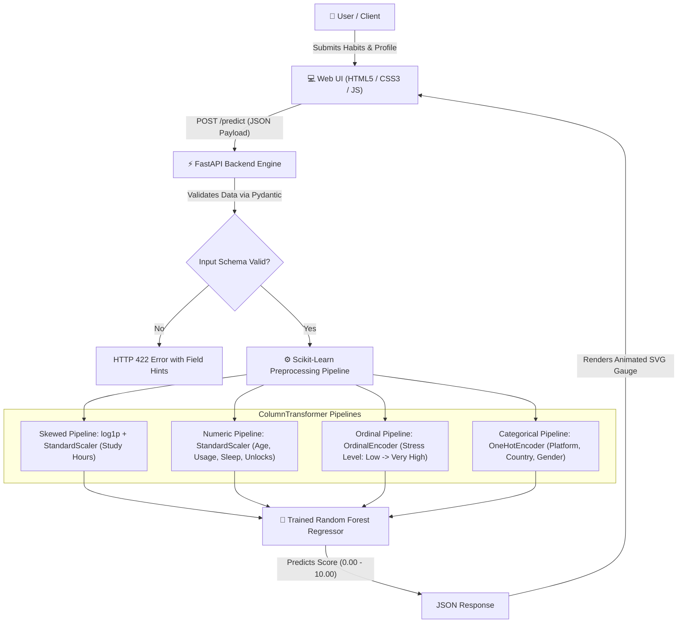

<div align="center">

# 🧠 Mental Health Score Predictor
### *Student Social Media & Lifestyle Wellness Analytics*

[](https://mental-health-score-predictor-a9ll.onrender.com)
[](https://mental-health-score-predictor-a9ll.onrender.com/docs)
[](https://www.python.org/)
[](https://scikit-learn.org/)
[](https://opensource.org/licenses/MIT)

<br/>

**An end-to-end Machine Learning web platform that models student daily habits, digital screen time, academic pressure, and lifestyle indicators to predict a holistic Mental Wellness Score (0–10).**

[🚀 Explore Live App](https://mental-health-score-predictor-a9ll.onrender.com) • [📖 Interactive Swagger API](https://mental-health-score-predictor-a9ll.onrender.com/docs) • [🛠️ Architecture](#-system-architecture) • [💻 Local Setup](#-getting-started-locally)

---

</div>

## 📌 Table of Contents

- [Overview](#-overview)
- [Key Features](#-key-features)
- [System Architecture](#-system-architecture)
- [Machine Learning Pipeline](#-machine-learning-pipeline)
- [Score Interpretation](#-score-interpretation)
- [API Reference](#-api-reference)
- [Repository Structure](#-repository-structure)
- [Getting Started Locally](#-getting-started-locally)
- [Docker & Containerization](#-docker--containerization)
- [Cloud Deployment](#-cloud-deployment)
- [Ethical Disclaimer](#-ethical-disclaimer)
- [Author & Acknowledgments](#-author--acknowledgments)

---

## 🌟 Overview

Students and young adults face unprecedented digital exposure, shifting sleep schedules, and academic pressures. **Mental Health Score Predictor** (*Mansik-Santulan-Score*) is a production-grade machine learning application designed to quantify how daily lifestyle choices correlate with mental well-being.

Built from exploratory data analysis to deployed production, the system provides:
1. **Accurate Inference**: An ensemble Random Forest model trained on empirical student behavioral indicators.
2. **Lightning-Fast Asynchronous API**: Powered by FastAPI with robust Pydantic data validation and CORS support.
3. **Responsive Visual Interface**: Custom interactive web app featuring animated SVG radial gauge meters and real-time validation.

---

## ✨ Key Features

- **⚡ End-to-End Pipeline**: Unified preprocessing and regression pipeline bundled in a single serialized artifact using `joblib`.
- **🛡️ Type-Safe Validation**: Every input is validated against schema constraints (`Pydantic v2`) preventing runtime failures.
- **🎨 Radial Gauge UI**: Dynamic SVG dashboard rendering real-time score bands (Strained, Balanced, Strong) with visual feedback.
- **🌐 Universal Deployment Ready**: Includes production configurations for **Render** (`render.yaml`), **Docker** (`Dockerfile`), and **Hugging Face Spaces**.
- **📊 Robust Preprocessing**: Automatically handles skewed distributions, ordinal stress levels, and one-hot encoded categorical parameters.

---

## 🏗️ System Architecture



---

## 🔬 Machine Learning Pipeline

The project implements a full scikit-learn `Pipeline` paired with a `ColumnTransformer` to ensure zero data leakage between training and inference:

| Feature Category | Features Included | Preprocessing Technique |
| :--- | :--- | :--- |
| **Skewed Numeric** | `Study_Hours` | `FunctionTransformer(np.log1p)` ➔ `StandardScaler()` |
| **Standard Numeric** | `Age`, `Avg_Daily_Usage_Hours`, `Daily_Unlocks`, `Physical_Activity_Hours`, `Sleep_Hours_Per_Night` | `StandardScaler()` |
| **Ordinal Categorical** | `Stress_Level` (`Low`, `Medium`, `High`, `Very High`) | `OrdinalEncoder(categories=[['Low','Medium','High','Very High']])` |
| **Nominal Categorical** | `Gender`, `Academic_Level`, `Most_Used_Platform`, `Purpose_Of_Use`, `Grouped_country` | `OneHotEncoder(handle_unknown='ignore')` |
| **Estimator** | *All Transformed Features* | `RandomForestRegressor(random_state=42)` |

---

## 🎯 Score Interpretation

Predictions range on a scale from **0.0 to 10.0**, categorized into 3 actionable wellness signals:

| Score Range | Signal Tier | Diagnostic Context |
| :---: | :---: | :--- |
| **0.0 – 3.9** | 🔴 **Signal: Strained** | Elevated strain indicated. Small shifts in sleep duration, phone unlock reduction, or screen-time limits can significantly restore balance. |
| **4.0 – 6.9** | 🟡 **Signal: Balanced** | Steady baseline rhythm observed, with moderate room for rest, recovery, and screen moderation. |
| **7.0 – 10.0** | 🟢 **Signal: Strong** | High resilience baseline. Habits point to well-supported sleep, physical activity, and balanced digital consumption. |

---

## 📡 API Reference

### Health Check
```http
GET /health
```
**Response (200 OK):**
```json
{
  "status": "healthy",
  "message": "Mental Health Score Predictor API is online"
}
```

---

### Predict Mental Health Score
```http
POST /predict
Content-Type: application/json
```

#### Request Body
```json
{
  "age": 21,
  "gender": "Male",
  "country": "India",
  "academic_level": "Undergraduate",
  "most_used_platform": "YouTube",
  "purpose_of_use": "Education",
  "avg_daily_usage_hours": 3.0,
  "daily_unlocks": 40,
  "study_hours": 5.5,
  "physical_activity_hours": 1.5,
  "sleep_hours_per_night": 7.5,
  "stress_level": "Low"
}
```

#### Response (200 OK)
```json
{
  "predicted_mental_health_score": 8.16
}
```

#### cURL Example
```bash
curl -X POST "https://mental-health-score-predictor-a9ll.onrender.com/predict" \
     -H "Content-Type: application/json" \
     -d '{"age":21,"gender":"Male","country":"India","academic_level":"Undergraduate","most_used_platform":"YouTube","purpose_of_use":"Education","avg_daily_usage_hours":3.0,"daily_unlocks":40,"study_hours":5.5,"physical_activity_hours":1.5,"sleep_hours_per_night":7.5,"stress_level":"Low"}'
```

---

## 📂 Repository Structure

```
Mental-Health-Score-Predictor/
├── .github/                                     # GitHub configurations
├── Dockerfile                                   # Container specification (UID 1000, port 7860/8000)
├── Procfile                                     # Cloud process command definition
├── render.yaml                                  # Render Infrastructure-as-Code deployment file
├── requirements.txt                             # Production Python dependencies
├── README.md                                    # Comprehensive project documentation
├── main.py                                      # FastAPI backend & static file server
├── run_server.py                                # Convenience entrypoint script
├── Mental_Health_Model.pkl                      # Serialized ML Pipeline (Git LFS)
├── Student Social Media And Mental Health Impact.csv # Empirical dataset used for modeling
├── ML_Project.ipynb                             # Model training and exploration notebook
├── ML Project.html                              # Pipeline architectural blueprint
├── index.html                                   # Interactive web interface
├── style.css                                    # Custom design tokens & layout
└── script.js                                    # Client-side validation & async API caller
```

---

## 💻 Getting Started Locally

### 1. Clone the Repository
```bash
git clone https://github.com/AryanRaj2608/Mental-Health-Score-Predictor.git
cd Mental-Health-Score-Predictor
```

### 2. Set Up a Virtual Environment
```bash
# macOS/Linux
python3 -m venv venv
source venv/bin/activate

# Windows (PowerShell)
python -m venv venv
.\venv\Scripts\Activate.ps1
```

### 3. Install Dependencies
```bash
pip install --upgrade pip
pip install -r requirements.txt
```

### 4. Run the Application
```bash
python main.py
```
Or directly with Uvicorn:
```bash
uvicorn main:app --reload --host 127.0.0.1 --port 8000
```

Open your browser at **[http://127.0.0.1:8000](http://127.0.0.1:8000)**.

---

## 🐳 Docker & Containerization

Build and run the application containerized with zero local environment setup:

```bash
# Build the Docker image
docker build -t mental-health-predictor .

# Run the container on port 8000
docker run -p 8000:7860 mental-health-predictor
```

Access the app at **[http://localhost:8000](http://localhost:8000)**.

---

## ☁️ Cloud Deployment

### 1. Render (Active Production)
- Deployed at: **[https://mental-health-score-predictor-a9ll.onrender.com](https://mental-health-score-predictor-a9ll.onrender.com)**
- Uses the included `render.yaml` specification for automated builds.

### 2. Hugging Face Spaces
- Docker-based space: **[Aryan0026/mental-health-score-predictor](https://huggingface.co/spaces/Aryan0026/mental-health-score-predictor)**
- Complies with Hugging Face Docker SDK guidelines (non-root user `1000`, Git LFS for binary models).

---

## ⚠️ Ethical Disclaimer

> **Important**: This software application is built exclusively for research, educational, and informational demonstration purposes. It **does not constitute medical, psychological, or clinical diagnosis or advice**. Anyone experiencing mental health distress or crisis should contact professional healthcare providers or crisis support hotlines.

---

## 👤 Author & Acknowledgments

- **Author**: Aryan Raj ([@AryanRaj2608](https://github.com/AryanRaj2608))
- **Dataset**: Student Social Media & Mental Health Impact Study
- **Frameworks**: [FastAPI](https://fastapi.tiangolo.com/), [Scikit-Learn](https://scikit-learn.org/), [Uvicorn](https://www.uvicorn.org/)

---

<div align="center">
  <sub>Built with ❤️ for student wellness awareness. Star ⭐ the repository if you found this project helpful!</sub>
</div>
